# API de usuarios y preferencias de Twitch

**Autor:** Fran Sabater Estellés

**Curso académico:** 2026-2027 

**Formación:** Máster en Desarrollo de Aplicaciones Web

**Repositorio:** [UE_M2_Task1](https://github.com/fjsabater-dev/UE_M2_Task1)

---

## Índice

1. [Introducción](#1-introducción)
2. [Enfoque de la tarea](#2-enfoque-de-la-tarea)
   - [2.1 Tecnologías](#21-tecnologías)
   - [2.2 Flujo de trabajo con Git](#22-flujo-de-trabajo-con-git)
   - [2.3 Plan de ramas](#23-plan-de-ramas)
   - [2.4 Alternativas a las tecnologías elegidas](#24-alternativas-a-las-tecnologías-elegidas)
3. [Desarrollo rama a rama](#3-desarrollo-rama-a-rama)
   - [3.1 `feature/InitialEnv`](#31-featureinitialenv)
   - [3.2 `feature/ProjectStructure`](#32-featureprojectstructure)
   - [3.3 `feature/DatabaseConnection`](#33-featuredatabaseconnection)
   - [3.4 `feature/UserPreferences`](#34-featureuserpreferences)
   - [3.5 `feature/TwitchIntegration`](#35-featuretwitchintegration)
   - [3.6 `feature/TestsDocs`](#36-featuretestsdocs)
4. [Conclusiones y observaciones](#4-conclusiones-y-observaciones)
5. [Bibliografía](#5-bibliografía)

---

## 1. Introducción

Esta práctica consiste en desarrollar una API RESTful que gestione usuarios y sus preferencias de Twitch, guarde los datos en MySQL y consuma la API externa de Twitch para obtener información sobre streamers y juegos.

**Objetivos:**

1. Crear una API RESTful con FastAPI.
2. Usar JSON para el intercambio de datos entre cliente y servidor.
3. Integrar la API externa de Twitch.
4. Implementar validación de datos y manejo de errores.
5. Documentar y probar la API con herramientas interactivas.

## 2. Enfoque de la tarea

### 2.1 Tecnologías

| Tecnología | Uso | Motivo |
|------------|-----|--------|
| **FastAPI** | Framework de la API | Validación automática con Pydantic, documentación interactiva generada sola y muy extendido en APIs modernas |
| **Uvicorn** | Servidor | FastAPI define la API, pero es Uvicorn quien escucha las peticiones de red y se las pasa |
| **Pydantic** | Validación de datos | Viene con FastAPI; comprueba tipos y rangos de los datos de entrada |
| **MySQL** | Base de datos | Almacena usuarios y preferencias |
| **requests** | Cliente HTTP | Librería usada en clase para llamar a APIs externas; sencilla y síncrona |
| **API de Twitch** | Datos de streamers y juegos | Fuente oficial de la información que pide la tarea |
| **JSON** | Formato de datos | Estándar de intercambio en APIs REST |
| **Swagger UI y Bruno** | Documentación y pruebas | Swagger lo genera FastAPI; Bruno permite probar peticiones |

### 2.2 Flujo de trabajo con Git

Se trabaja con ramas `feature/<Nombre>`, que se integran en la rama de desarrollo `develop` mediante pull request. Al terminar la tarea, `develop` se integra en la rama de producción `main`. Cada rama aborda una única parte del proyecto y se cierra con uno o dos commits por bloque funcional, de modo que el avance es gradual y cada paso se puede revisar y probar por separado.

### 2.3 Plan de ramas

Plan actual, ajustado respecto al inicial al fusionar ramas que no tenían sentido por separado:

| # | Rama | Objetivo |
|---|------|----------|
| 1 | `feature/InitialEnv` | Entorno virtual y `requirements.txt` |
| 2 | `feature/ProjectStructure` | Estructura inicial y aplicación mínima |
| 3 | `feature/DatabaseConnection` | Conexión con MySQL y CRUD de usuarios |
| 4 | `feature/UserPreferences` | Preferencias de usuario (streamers y juegos favoritos) |
| 5 | `feature/TwitchIntegration` | Cliente de la API de Twitch y manejo de sus errores |
| 6 | `feature/TestsDocs` | Colección de Bruno y cierre de la documentación |

### 2.4 Tecnologías usadas

Se ha elegido trabajar con FastAPI debido a que mi parecer es un entorno más amigable para alguien que está empezando a trabajar en estos entornos. Además me llamo realmente la atención que se pudieran validar los datos en este framework, cosa que me pone más fácil entender lo que voy haciendo y hacer pruebas rápidas para ver todo funciona gracias a la documentación interactiva del /docs. También el que sea una tecnología más reciente y que ahora se esté usando en mayor medida para desarrollar nuevas aplicaciones también ha sido un punto de inflexión en la elección del framework. Lo único que he tenido que prestar atención es a que FastAPI es asíncrono, por lo que había partes del desarrollo en los que había que tenerlo en cuenta. En conclusión, entiendo que ambos frameworks tienen sus ventajas y deventajas, pero la verdad es que trabajar con FastAPI, ha sido muy satisfactorio. Igual en la siguiente tarea pruebo a trabajar con Flask, para poder tener nociones de ambos frameworks.

Otra 

---

## 3. Desarrollo rama a rama

Cada rama se explica con la misma estructura: qué **decisión** llevó a crearla, qué se hizo y por qué (**justificación**) y cómo queda el proyecto al terminar (**conclusión**).

### 3.1 `feature/InitialEnv`

#### 3.1.1 Decisión

Antes de escribir código hace falta un entorno de trabajo controlado. Por eso la primera rama no contiene funcionalidad, solo la preparación del proyecto.

#### 3.1.2 Justificación

Se crea un entorno virtual `.venv` y un archivo `requirements.txt`. El entorno virtual aísla las dependencias del proyecto de las del resto del sistema, evitando conflictos de versiones con otros proyectos. El `requirements.txt` lista las dependencias, de modo que el mismo entorno se puede recrear en cualquier máquina con `pip install -r requirements.txt`.

#### 3.1.3 Conclusión

El proyecto dispone de un entorno reproducible. El siguiente paso es crear la estructura inicial de la aplicación.

### 3.2 `feature/ProjectStructure`

#### 3.2.1 Decisión

Antes de añadir funcionalidad conviene tener una aplicación mínima que arranque y responda, para construir cada rama posterior sobre una base ya comprobada. Esta rama define cómo se organiza el código al empezar, sin anticipar carpetas que todavía no se necesitan: la estructura crecerá en las ramas que lo requieran.

#### 3.2.2 Justificación

Estructura creada:

```
app/
├── __init__.py
├── main.py
└── routers/
    ├── __init__.py
    ├── health.py
    └── root.py
```

- **`__init__.py`:** archivo que indica a Python que la carpeta es un paquete importable. Puede estar vacío.
- **`main.py`:** crea la aplicación y conecta los routers. Se limita a ensamblar, sin contener endpoints.
- **`routers/`:** cada endpoint vive en su propio archivo, dentro de un `APIRouter`. Se separa desde el principio para que `main.py` no crezca sin control cuando se añadan más rutas.

```python
from fastapi import FastAPI
from app.routers import health, root

app = FastAPI(
    # Swagger information
    title="Twitch Preferences API",
    description="REST API for managing Twitch user streamers and categories preferences.",
  )

app.include_router(health.router)
app.include_router(root.router)
```

- **`health.py`:** `GET /health` devuelve `{"status": "ok"}`. Es una convención para comprobar que el servicio está vivo.
- **`root.py`:** `GET /` devuelve el nombre de la API, su versión y la ruta de la documentación. Se oculta de Swagger (`include_in_schema=False`) porque no forma parte del contrato de la API.

Los endpoints se registran con un decorador por método HTTP (`@router.get`, `@router.post`...), que es lo que permite a FastAPI validar los datos y generar la documentación. Además se configura el `.gitignore`, incluyendo `.env` para que las futuras credenciales nunca se suban al repositorio.

Para ejecutar la aplicación desde la raíz del proyecto:

```bash
fastapi dev app/main.py
```

Este comando lanza Uvicorn por debajo, con recarga automática. FastAPI genera `/openapi.json` a partir del código y Swagger UI lo muestra en `/docs`.

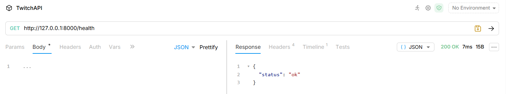

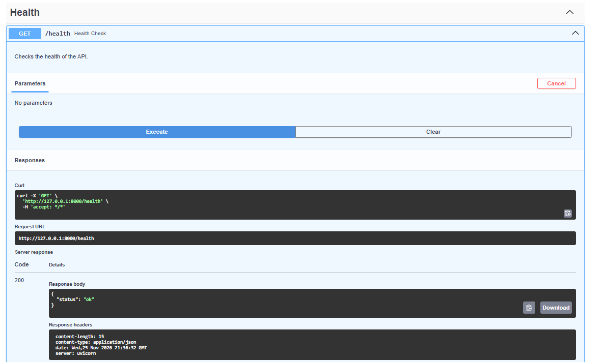

#### 3.2.3 Conclusión

La aplicación arranca, responde y se documenta sola. La estructura se mantiene deliberadamente pequeña: las carpetas para esquemas y configuración se crearán cuando las ramas correspondientes las necesiten. El siguiente paso es conectar la aplicación con MySQL.

### 3.3 `feature/DatabaseConnection`

#### 3.3.1 Decisión

Con la estructura base lista, el siguiente paso es guardar datos y poder operar sobre ellos. Esta rama toma tres decisiones:

- **Conector y SQL a mano, siguiendo lo visto en clase.** Se usa `mysql.connector` y las sentencias SQL se escriben directamente. Es el enfoque trabajado en clase, tiene menos conceptos nuevos y obliga a entender qué se ejecuta en la base de datos.
- **Credenciales fuera del código.** Se leen de un archivo `.env`, que no se sube al repositorio, con una plantilla `.env.template` que sí se versiona.
- **Conexión y CRUD de usuarios en una misma rama.** Una conexión sin endpoints no tiene nada que demostrar, con el primer endpoint se comprueba que funciona.

#### 3.3.2 Justificación

**Base de datos y usuario dedicado.** En MySQL se crea la base `twitch_api` con codificación `utf8mb4` (el UTF-8 completo, necesario para acentos, `ñ` y emojis en nombres de Twitch) y un usuario con permisos solo sobre esa base. La aplicación no usa `root`: es el superusuario del servidor y no queremos que sea visible por seguridad.

La tabla se crea a mano, como en clase, y el script se guarda en `sql/` para que el proyecto sea reproducible:

```sql
CREATE TABLE IF NOT EXISTS users (
    id INT AUTO_INCREMENT PRIMARY KEY,
    username VARCHAR(50) NOT NULL,
    email VARCHAR(255) NOT NULL,
    age INT NOT NULL
);
```

`AUTO_INCREMENT` hace que MySQL asigne el `id` solo, y `PRIMARY KEY` lo convierte en el identificador único de cada fila, el que se usa en las URL (`/users/5`).

**Configuración con `.env`.** Las credenciales van en un `.env` ignorado por Git (`.gitignore`); `.env.template` documenta qué variables hacen falta sin contener valores. Quien clone el proyecto copia la plantilla a `.env` y la rellena. Si una credencial llegara a subirse por error, habría que cambiarla, porque borrar el commit no basta: Git conserva el historial.

```
DB_HOST=localhost
DB_USER=
DB_PASSWORD=
DB_NAME=
```

**Conexión modular.** Siguiendo la estructura de clase, la conexión vive en `app/configuration/connections.py`, dentro de una clase reutilizable con distintas bases de datos:

```python
class DatabaseConnection:
    def __init__(self, host: str, user: str, password: str, database: str):
        self.host = host
        self.user = user
        self.password = password
        self.database = database
        self.mydb = None

    async def get_db_connection(self):
        if self.mydb is None: # Connect first time. Later calls the same object
            self.mydb = mysql.connector.connect(
                host=self.host,
                user=self.user,
                password=self.password,
                database=self.database,
                charset="utf8mb4",
            )
        return self.mydb

def get_default_database() -> DatabaseConnection: # Connection to the db with the .env credentials
    return DatabaseConnection(
        host=os.getenv("DB_HOST"),
        user=os.getenv("DB_USER"),
        password=os.getenv("DB_PASSWORD"),
        database=os.getenv("DB_NAME")
    )
```

`get_default_database()` es lo único añadido a la estructura de clase: evita repetir en cada endpoint la lectura de las credenciales. El `.env` se carga una vez al arrancar, con `load_dotenv()` en `main.py`. La comprobación de la conexión se hizo con un script temporal, que no se sube al repositorio.

**Validación con Pydantic.** Los datos de entrada se describen con dos modelos en `app/schemas/user.py`: `UserCreate` (todos los campos obligatorios) y `UserUpdate` (todos opcionales).

```python
class UserCreate(BaseModel):
    username: str = Field(..., min_length=1, max_length=50) # ... means required field
    email: str = Field(..., min_length=1, max_length=50)
    age: int = Field(..., ge=0, le=120)

class UserUpdate(BaseModel):
    username: str = Field(None, min_length=1, max_length=50) # None means optional field
    email: str = Field(None, min_length=1, max_length=50)
    age: int = Field(None, ge=0, le=120)
```

Si un dato no cumple las reglas, FastAPI responde automáticamente con un `422` y el código del endpoint no llega a ejecutarse. Así se reparte la validación: **Pydantic** comprueba la forma de los datos (tipo y rango); los **`if` manuales** comprueban situaciones propias de la lógica (no se envía ningún campo, el usuario no existe).

Los endpoints reciben el modelo directamente (`user: UserCreate`), como en el endpoint `/users-validation` visto en clase, en lugar de leer el JSON a mano con `Request`, que no valida nada.

**Endpoints.** Están en `app/routers/users.py`, con el prefijo `/users`:

| Operación | Endpoint | SQL | Respuesta de éxito | Errores |
|-----------|----------|-----|--------------------|---------|
| Crear | `POST /users` | `INSERT` | 201 con el usuario creado | 422 |
| Listar | `GET /users` | `SELECT` | 200 con la lista | — |
| Leer uno | `GET /users/{user_id}` | `SELECT ... WHERE id = %s` | 200 | 404, 422 |
| Actualizar | `PUT /users/{user_id}` | `UPDATE` | 200 con mensaje | 400, 404, 422 |
| Eliminar | `DELETE /users/{user_id}` | `DELETE` | 200 con mensaje | 404, 422 |

Todos siguen el mismo esqueleto: abrir conexión y cursor, ejecutar dentro de un `try`, hacer `commit()` si se modifican datos y cerrar cursor y conexión en el `finally`, de modo que nunca quedan abiertos aunque se lance un error. Los valores se pasan siempre con marcadores `%s` y una tupla, nunca pegados en el texto del SQL, lo que evita la inyección SQL. En los `SELECT` se usa `cursor(dictionary=True)` para devolver cada fila como un diccionario (JSON con nombres de campo) en lugar de una tupla.

**`PUT`: actualización parcial.** Como en clase, solo se actualizan los campos que llegan. El `UPDATE` se construye con dos listas: una con las piezas del `SET` (`"age = %s"`) y otra con sus valores, que `execute` recibe por separado:

```python
update_fields = []   # pieces of the SET clause, e.g. "age = %s"
update_values = []   # values for those placeholders, in the same order
if user.age is not None:
    update_fields.append("age = %s")
    update_values.append(user.age)
# ... same for username and email

update_values.append(user_id)  # the last %s is the WHERE
cursor.execute(
    f"UPDATE `users` SET {', '.join(update_fields)} WHERE id = %s;",
    tuple(update_values),
)
```

El f-string solo une texto fijo escrito por nosotros (nombres de columna); ningún dato del cliente entra en el SQL. Se usa `is not None` en lugar de un `if` simple, porque `if user.age:` sería falso para `0` y una edad válida se ignoraría en silencio. Si no llega ningún campo se responde `400`.

**El falso 404 del `rowcount`.** La primera versión detectaba el `404` como en clase, con `if cursor.rowcount == 0` después del `UPDATE`. Al probarla se observó que, **repitiendo dos veces la misma petición**, la segunda devolvía `404` aunque el usuario existía. La causa es que MySQL, por defecto, cuenta en `rowcount` las filas *modificadas*, no las *encontradas*: si los valores son iguales a los guardados, no se modifica nada y `rowcount` vale `0`.

La solución adoptada es comprobar antes de actualizar que el usuario existe:

```python
cursor.execute("SELECT id FROM users WHERE id = %s", (user_id,))
if cursor.fetchone() is None:  # None means no row was found
    raise HTTPException(status_code=404, detail="User not found")
```

Así el `404` depende de que el usuario exista y no de si MySQL cambió algo. Cuesta una consulta más, irrelevante con este volumen de datos. Se descartó la otra alternativa, activar la opción `FOUND_ROWS` del conector, por añadir un detalle técnico de MySQL que no aporta a los objetivos de la tarea.

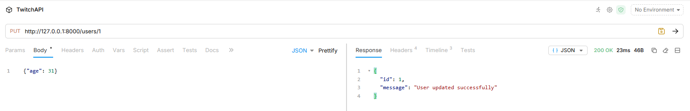

**`buffered=True`.** El cursor de estos endpoints se crea con `buffered=True`. Un cursor normal lee las filas del resultado a medida que se piden; si queda alguna sin leer y se ejecuta otra consulta con la misma conexión, el conector lanza `Unread result found`. Con `buffered=True` se descarga el resultado completo al ejecutar la consulta, así que no puede quedar nada pendiente. En las consultas por `id` el resultado tiene como máximo una fila, por lo que probablemente funcionaría sin él, pero se mantiene como garantía: cuesta casi nada y protege si la consulta cambia.

**`DELETE`.** El `DELETE` y la lectura de un usuario por id no se vieron en clase; se implementan con el mismo esqueleto que el resto. Se comprueba la existencia antes de borrar, igual que en el `PUT`. Como respuesta de éxito se eligió un `200` con el `id` y un mensaje de confirmación, en lugar del `204` sin contenido que es habitual en borrados, para mantener el mismo estilo en todas las operaciones que modifican datos.

**Mejoras sobre el código de clase.** Varias coinciden con las notas que el propio profesor deja como pendientes en su código:

| En clase | En el proyecto | Motivo |
|----------|----------------|--------|
| Credenciales escritas en cada endpoint | Se leen del `.env` en un único sitio | Evita filtrarlas y repetirlas |
| SQL con f-strings | Marcadores `%s` con una tupla | Evita la inyección SQL |
| El cursor no se cierra | `try/finally` con cierre de cursor y conexión | Evita recursos abiertos |
| `POST` sin validar y `POST` validado | Solo la versión con Pydantic | Todos los datos pasan por validación |
| `if age:` | `if user.age is not None:` | No ignora el valor `0` |
| Filas como tuplas | `dictionary=True` | JSON con nombres de campo |
| Endpoints en `main.py` | `APIRouter` en `routers/` | `main.py` no crece sin control |

**Pruebas.** Cada endpoint se probó en Swagger (`/docs`) y se contrastó el resultado en MySQL Workbench con `SELECT * FROM users;`:

| Petición | Resultado esperado |
|----------|--------------------|
| `POST /users` con datos válidos | 201 |
| `POST /users` con `"age": 200` | 422 |
| `GET /users` | 200 con la lista |
| `GET /users/9999` | 404 |
| `PUT /users/1` con `{"age": 31}`, dos veces seguidas | 200 las dos |
| `PUT /users/9999` | 404 |
| `PUT /users/1` con `{}` | 400 |
| `DELETE /users/{id}` | 200 con mensaje |
| `DELETE` repetido | 404 |

Swagger comprueba los tipos en el navegador antes de enviar la petición, por lo que, por ejemplo, un id no numérico (`/users/abc`) nunca llega al servidor y no se ve el `422`. Para observarlo conviene probar también con un cliente como Bruno.

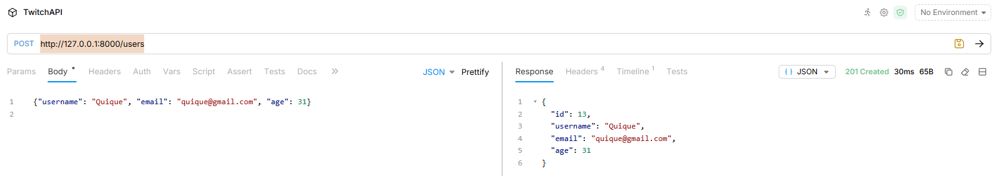

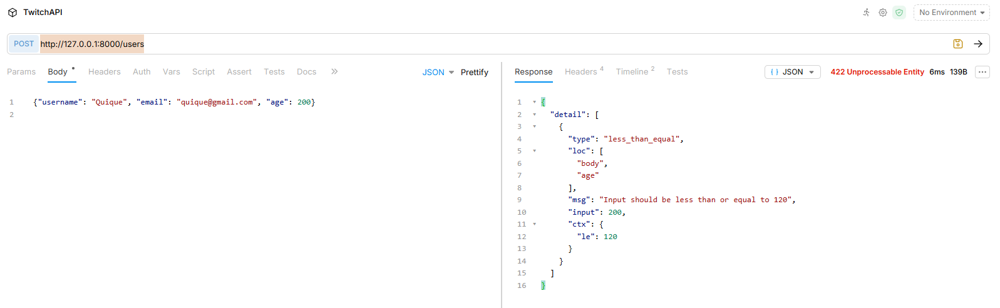

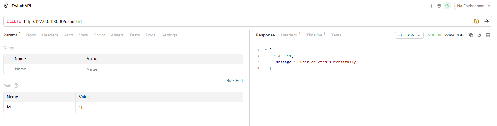

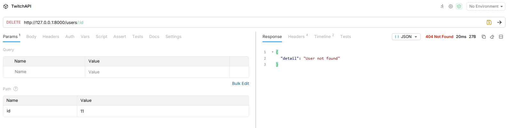

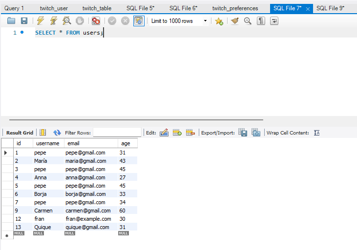

#### 3.3.3 Conclusión

La API ya gestiona usuarios de extremo a extremo: los datos viajan desde Swagger hasta MySQL y de vuelta, con validación de entrada y errores diferenciados (`400`, `404`, `422`). Se siguió el enfoque de clase (conector, SQL a mano, estructura de la conexión) incorporando las mejoras que el propio código de clase señalaba, y la prueba de cada endpoint permitió detectar y corregir el falso `404` del `PUT`. Los endpoints repiten la apertura y el cierre de la conexión; se mantiene explícito, como en clase, y se recoge como posible mejora. El siguiente paso es guardar las preferencias de cada usuario (`feature/UserPreferences`).

### 3.4 `feature/UserPreferences`

#### 3.4.1 Decisión

La tarea pide almacenar las preferencias de los usuarios en MySQL: sus streamers y sus juegos favoritos. Con el CRUD de usuarios terminado, esta rama añade ese almacenamiento. Se toman tres decisiones:

- **Una tabla nueva, relacionada con `users`.** Un usuario puede tener muchos favoritos, y una fila de `users` no puede contener un número variable de ellos; por eso cada favorito es una fila de una segunda tabla que apunta a su usuario (relación 1 a N).
- **Una única tabla para streamers y juegos**, con un campo `type` que distingue el tipo. Se descartó guardar listas dentro de una misma celda (por ejemplo `"ibai,auronplay"`) porque obliga a reescribir el texto entero para añadir o quitar un elemento y no permite buscar ni contar con SQL. Se descartó también una tabla por tipo porque duplicaría el código de los endpoints.
- **Guardar solo las claves de búsqueda de Twitch**, no los datos de Twitch. La referencia de la API indica qué se necesita para consultar cada recurso: el nombre de login para un streamer y el título exacto para un juego. Esos son los únicos datos que guarda la tabla. La información que devuelve Twitch (espectadores, título del directo, imágenes...) cambia constantemente, así que se consultará en el momento en la rama de integración, en lugar de duplicarla y mantenerla actualizada.

#### 3.4.2 Justificación

**La tabla `preferences`.** Cada fila es un favorito, y `user_id` lo enlaza con su usuario:

| id | user_id | type | name |
|----|---------|------|------|
| 1 | 1 | streamer | ibai |
| 2 | 1 | game | Minecraft |
| 3 | 2 | game | Zelda |

```sql
CREATE TABLE IF NOT EXISTS preferences (
    id INT AUTO_INCREMENT PRIMARY KEY,
    user_id INT NOT NULL,
    type ENUM('streamer', 'game') NOT NULL,
    name VARCHAR(100) NOT NULL,
    FOREIGN KEY (user_id) REFERENCES users(id) ON DELETE CASCADE
);
```

- **`ENUM('streamer', 'game')`:** MySQL solo acepta esos dos valores.
- **`FOREIGN KEY (user_id) REFERENCES users(id)`:** es una regla que obliga a que cada `user_id` exista en `users`, de modo que no pueden quedar preferencias huérfanas. Ambas columnas son del mismo tipo (`INT`), y `users` se crea antes.
- **`ON DELETE CASCADE`:** al borrar un usuario, MySQL borra también sus preferencias. Es necesario: sin esta cláusula, el `DELETE /users/{id}` de la rama anterior fallaría con un error de MySQL (`1451`) para cualquier usuario con preferencias, y la API respondería un `500`. Es un ejemplo de cómo una decisión de la base de datos afecta a endpoints ya existentes.

**Validación.** Se añade un modelo de entrada, `PreferenceCreate`, en `app/schemas/preferences.py`:

```python
class PreferenceCreate(BaseModel):
    type: Literal["streamer", "game"]
    # Only these two texts are valid; anything else gives a 422.
    name: str = Field(..., min_length=1, max_length=100)
    # Required (...), 1 to 100 characters, matching the VARCHAR(100) column.
```

`Literal` repite en la capa de validación las opciones del `ENUM`, de modo que un tipo no permitido se rechaza con un `422` claro antes de llegar a MySQL.

**Endpoints.** Están en `app/routers/preferences.py`, con rutas anidadas bajo el usuario:

| Operación | Endpoint | SQL | Respuesta de éxito | Errores |
|-----------|----------|-----|--------------------|---------|
| Añadir | `POST /users/{user_id}/preferences` | `INSERT` | 201 con la preferencia creada | 404, 422 |
| Listar | `GET /users/{user_id}/preferences` | `SELECT` | 200 con la lista | 404 |
| Quitar | `DELETE /users/{user_id}/preferences/{preference_id}` | `DELETE` | 200 con mensaje | 404 |

No se implementa `PUT`: para cambiar un favorito se borra y se vuelve a crear. Todos siguen el esqueleto de los endpoints de usuarios (conexión, ejecución con `%s`, `commit`, cierre en `finally`), y los detalles propios de esta rama son:

- **Si el usuario no existe se responde `404`**, tanto al añadir como al listar. En el listado es una decisión deliberada: una lista vacía significaría «el usuario existe pero no tiene favoritos», y no es lo mismo. La comprobación se escribe en cada endpoint, igual que en el `PUT` y el `DELETE` de usuarios.
- **El `DELETE` filtra por `id` y por `user_id`** (`WHERE id = %s AND user_id = %s`), de modo que no se puede borrar el favorito de otro usuario adivinando su id.
- **En el `DELETE`, `rowcount` es fiable**, a diferencia del `UPDATE` de la rama anterior: o se borra la fila o no existía, así que `rowcount == 0` significa `404` sin necesidad de un `SELECT` previo.

**Pruebas.** Se probaron todos los casos en Swagger y se comprobó el resultado en Workbench:

| Petición | Resultado esperado |
|----------|--------------------|
| `POST /users/1/preferences` con un streamer y con un juego | 201 |
| `POST` con `"type": "movie"` | 422 |
| `POST /users/9999/preferences` | 404 |
| `GET /users/1/preferences` | 200 con la lista |
| `GET /users/9999/preferences` | 404 |
| `DELETE /users/1/preferences/{id}`, y repetido | 200 y 404 |
| `DELETE /users/{id}` de un usuario con preferencias | 200, y sus preferencias desaparecen de la tabla |

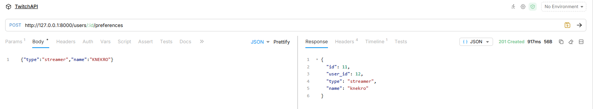

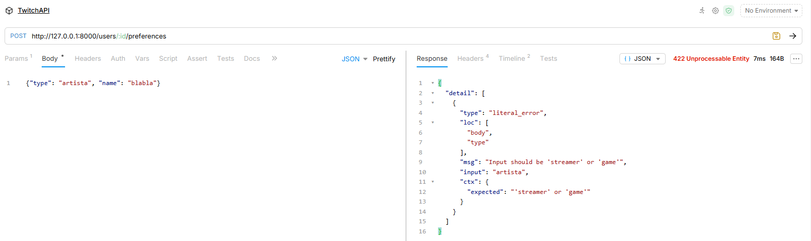

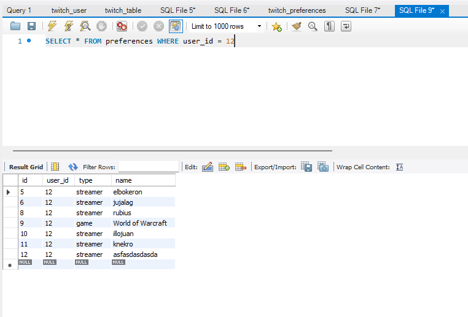

#### 3.4.3 Conclusión

Cada usuario puede guardar, consultar y quitar sus streamers y juegos favoritos, y la base de datos garantiza la coherencia entre las dos tablas gracias a la clave foránea. La tabla guarda solo lo necesario para consultar a Twitch, y esa decisión se apoya en la documentación de su API. El siguiente paso es `feature/TwitchIntegration`, donde se obtiene el token de la aplicación, se consulta a Twitch con esos nombres y se tratan los errores que puedan venir del servicio externo.

### 3.5 `feature/TwitchIntegration`

#### 3.5.1 Decisión

La tarea pide integrar la API externa de Twitch para trabajar con streamers y juegos favoritos. Esta rama conecta la API con Twitch y la usa de dos formas:

- **Validar los favoritos al guardarlos.** Antes de insertar un streamer o un juego, se comprueba que existe en Twitch. Si no existe, no se guarda y se responde `404`.
- **Consultar a los streamers favoritos de un usuario**: si están en directo, a qué juego juegan y cuántos espectadores tienen.

Además se toman cuatro decisiones de diseño:

- **Una capa de servicio separada** (`app/service/twitch_service.py`), siguiendo la estructura de clase con `service/openweathermap_service`. El servicio habla con Twitch; el router solo recibe la petición y devuelve la respuesta.
- **Funciones `def` síncronas** en el servicio y en los endpoints de Twitch, porque la librería `requests` es bloqueante. Es el mismo criterio que el endpoint `/weather/{city}` visto en clase.
- **Token de aplicación**, sin usuario de Twitch. Los tres recursos que necesitamos (usuarios, directos y juegos) son datos públicos y se pueden consultar con un token de aplicación, obtenido con el flujo *client credentials*. Consultar los canales que sigue un usuario concreto exigiría un token de usuario y un flujo de login, y queda fuera del alcance de la tarea.
- **Los errores de Twitch se traducen a códigos HTTP claros**, de modo que la API nunca responde un `500` genérico por un fallo del servicio externo.

#### 3.5.2 Justificación

**Credenciales.** Twitch no permite usar su API de forma anónima. Se registra una aplicación en `dev.twitch.tv/console`, que da un *Client ID* y un *Client Secret*. Se guardan en el `.env` como `TWITCH_CLIENT_ID` y `TWITCH_CLIENT_SECRET`, igual que la contraseña de MySQL, y el `.env.template` solo incluye los nombres sin valores.

**Obtención del token.** Con esas credenciales se hace un `POST` a `https://id.twitch.tv/oauth2/token` con `grant_type=client_credentials`. Cada llamada posterior a la API lleva dos cabeceras: `Authorization: Bearer <token>` y `Client-Id`. El token se guarda en una variable del módulo para no pedir uno nuevo en cada petición; si Twitch responde `401` (token caducado), se descarta, se pide otro y se reintenta una sola vez.

**Funciones del servicio.**

| Función | Llamadas a Twitch | Resultado |
|---------|-------------------|-----------|
| `get_streamer(login)` | `GET /helix/users?login=` y `GET /helix/streams?user_login=` | Perfil del streamer, `is_live` y, si está en directo, título, juego y espectadores |
| `get_game(name)` | `GET /helix/games?name=` | `id`, `name` y `box_art_url` del juego |

- El endpoint de directos **solo devuelve datos si el streamer está emitiendo**: una lista vacía significa que no está en directo. Por eso `get_streamer` combina dos llamadas: la primera comprueba que el streamer existe y la segunda averigua si está en directo.
- `get_game` busca por nombre exacto.
- Las funciones devuelven solo los campos necesarios, no la respuesta completa de Twitch.

**Manejo de errores.**

| Situación | Código | Motivo |
|-----------|--------|--------|
| Streamer o juego inexistente | 404 | Twitch devuelve una lista vacía |
| Faltan las credenciales en el `.env` | 503 | La funcionalidad de Twitch no está disponible; el resto de la API sigue funcionando |
| Twitch no responde en 10 segundos | 504 | Se usa `timeout`; sin él, una petición podría quedarse esperando indefinidamente |
| Twitch no se alcanza, rechaza el secret o responde algo inesperado | 502 | El fallo está en el servicio externo, no en nuestra API |

El servicio lanza directamente `HTTPException`. Es más simple que crear excepciones propias, a costa de acoplar el servicio a FastAPI.

**Cambio en `POST /users/{user_id}/preferences`.** Tras comprobar que el usuario existe y antes del `INSERT`, se consulta a Twitch:

```python
if preference.type == "streamer":
    twitch_data = get_streamer(preference.name)
    name = twitch_data["login"]  # official name written by Twitch
else:
    twitch_data = get_game(preference.name)
    name = twitch_data["name"]  # official name written by Twitch
```

- Si el streamer o el juego no existen, la función lanza el `404` y el `INSERT` no llega a ejecutarse.
- Basta un `if/else` porque `Literal` ya rechazó con `422` cualquier otro tipo.
- Se guarda `name`, el nombre oficial devuelto por Twitch, y no lo que escribió el usuario: así `IBAI`, `Ibai` e `ibai` no acaban como favoritos distintos.

**Endpoints nuevos** (`app/routers/twitch.py`):

| Endpoint | Descripción | Errores |
|----------|-------------|---------|
| `GET /twitch/streamers/{login}` | Datos de un streamer y si está en directo | 404, 502, 503, 504 |
| `GET /twitch/games/{name}` | Datos de un juego | 404, 502, 503, 504 |
| `GET /users/{user_id}/streamers` | Estado de los streamers favoritos del usuario | 404, 502, 503, 504 |

`GET /users/{user_id}/streamers` es `async def` porque `get_db_connection()` es asíncrona y necesita `await`. Busca en MySQL los favoritos de tipo `streamer`, cierra la conexión y después pregunta a Twitch por cada uno. La conexión se cierra antes de llamar a Twitch para no mantenerla abierta mientras se espera a un servicio externo.

**Pruebas.** Se probaron con Bruno, que permite comprobar también los códigos de error y modificar el `.env` para provocarlos:

| Petición | Resultado esperado |
|----------|--------------------|
| `POST /users/1/preferences` con un streamer real | 201, con el nombre en minúsculas |
| `POST` con un streamer inexistente | 404, y no se guarda |
| `POST` con un juego real / inexistente | 201 / 404 |
| `POST /users/9999/preferences` | 404 |
| `POST` con `"type": "movie"` | 422 |
| `GET /users/1/streamers` | 200 con `is_live` y los datos del directo si lo hay |
| `GET /users/9999/streamers` | 404 |
| `GET /twitch/streamers/{login}` real / inexistente | 200 / 404 |
| `GET /twitch/games/{name}` real / inexistente | 200 / 404 |
| `TWITCH_CLIENT_SECRET` falso | 502 |
| `TWITCH_CLIENT_SECRET` vacío | 503 |

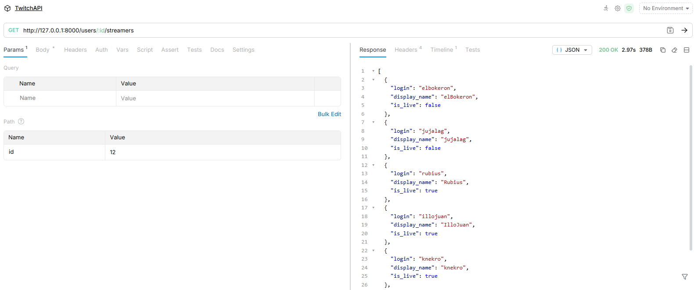

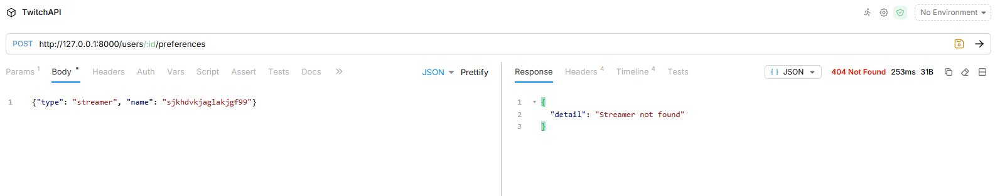

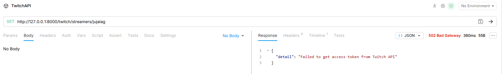

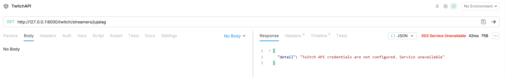

#### 3.5.3 Conclusión

La API valida los favoritos contra Twitch antes de guardarlos y permite consultar en tiempo real el estado de los streamers favoritos de cada usuario. Los fallos del servicio externo se traducen a códigos HTTP concretos (404, 502, 503 y 504) y no producen errores `500` genéricos. El siguiente paso es `feature/TestsDocs`: colección de Bruno, cierre de la documentación y entrega.

---

### 3.6 `feature/TestsDocs`

#### 3.6.1 Decisión

Esta última rama no añade funcionalidad a la API. Reúne las pruebas y cierra la documentación:

- **Guardar la colección de Bruno en el repositorio** (carpeta `bruno/`), para que las pruebas se puedan repetir y revisar.
- **No añadir tests automáticos.** Las pruebas funcionales de cada rama se hicieron con Bruno, que es la herramienta que pide la tarea, y cubren los casos de éxito y los de error (404, 422, 502, 503). Los tests automáticos con `pytest` se dejan como mejora futura.
- **Cerrar la documentación**: conclusiones, capturas y enlace al repositorio.

#### 3.6.2 Justificación

**Colección de Bruno.** Bruno guarda cada petición como un archivo de texto, así que la colección se puede versionar con Git igual que el código. Con ella, cualquiera puede clonar el repositorio, arrancar la API y repetir todas las pruebas sin tener que reconstruir las peticiones a mano.

**Sin secretos.** La colección no contiene credenciales: las peticiones solo apuntan a la API local mediante la variable `baseUrl` del entorno `local`. El Client ID y el Client Secret de Twitch están en el `.env` del servidor, que no se sube a Git, y las llamadas a Twitch las hace la API, no Bruno.

**Cómo usarla.**

1. Crear la base de datos con `sql/twitch_table.sql` y configurar el `.env` (ver el `README`).
2. Arrancar la API con `fastapi dev app/main.py`.
3. En Bruno, abrir la colección de la carpeta `bruno/` y seleccionar el entorno `local`.
4. Ejecutar las peticiones; los resultados esperados de cada rama están en sus tablas de pruebas.

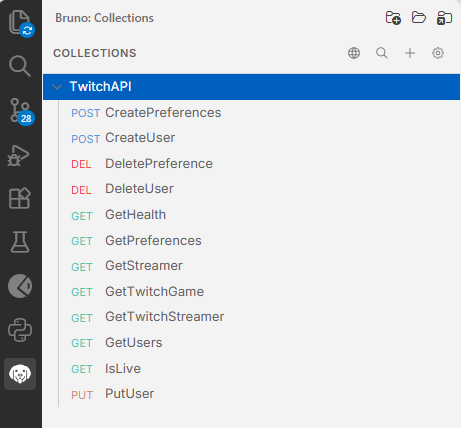

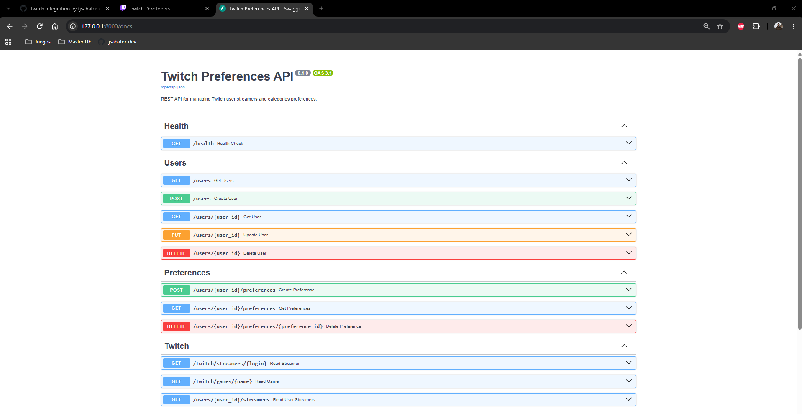

#### 3.6.3 Conclusión

La API queda probada de extremo a extremo y las pruebas son reproducibles. Con la documentación cerrada, el último paso es integrar `develop` en `main` mediante un pull request.

### 3.7 `feature/Documentation`

#### 3.7.1 Decisión

Esta rama no modifica el código de la API. Añade al repositorio la documentación de la entrega y la conecta con el resto del proyecto. Se toman tres decisiones:

- **Una rama propia para la documentación**, separada de `feature/TestsDocs`. Esa rama reúne la colección de Bruno y las instrucciones de prueba; esta incorpora el documento final y sus imágenes.
- **Un único documento, `DOCUMENTACION.md`, en la raíz del repositorio**, escrito en español porque es el documento de la entrega. El `README.md` se mantiene en inglés y enlaza a él.
- **Las capturas de pantalla se guardan en `docs/img/`** dentro del repositorio, en lugar de enlazarlas desde un servicio externo, para que el documento y las imágenes viajen juntos y no dependan de nada fuera del repo.

#### 3.7.2 Justificación

**Documento y `README` con funciones distintas.** El `README` es la puerta de entrada: explica qué es el proyecto, cómo instalarlo y ejecutarlo y qué endpoints tiene. `DOCUMENTACION.md` explica cómo se ha construido: las decisiones de cada rama, el código, las pruebas realizadas, las conclusiones y las observaciones. Por eso el último apartado del `README` indica dónde está la documentación y qué contiene.

**Imágenes con rutas relativas.** Cada captura se incluye con la sintaxis ``. Al ser rutas relativas a la raíz del repositorio, GitHub las muestra al abrir `DOCUMENTACION.md`, y también funcionan al abrir el archivo en local. Se nombran con un número y una descripción (`01-health.png`, `11-streamers-live.png`...) para identificar rápidamente cada una.

**Qué se ha incluido en las capturas.** Se capturan respuestas de la API, tanto de éxito como de error (`201`, `404`, `422`, `502`, `503`), y consultas en Workbench. Antes de guardarlas se comprobó que no muestran credenciales: ni el `.env`, ni el *Client Secret*, ni tokens de Twitch.

**Documento al final del proceso.** El documento se fue escribiendo rama a rama a medida que se desarrollaba la API, pero se incorporó al repositorio una vez terminadas todas las ramas funcionales. De este modo describe el estado final del proyecto y no se queda desfasado por cambios posteriores.

#### 3.7.3 Conclusión

El repositorio contiene ahora el código, la colección de pruebas y la documentación de la entrega, con el `README` como punto de entrada que enlaza con ella. Con esta rama integrada en `develop`, el último paso es el pull request de `develop` a `main`, que deja la versión final del proyecto en la rama principal.

---

## 4. Conclusiones y observaciones

### Resultado

Se ha construido una API REST con FastAPI que cumple los objetivos de la tarea: gestiona usuarios y sus favoritos en MySQL, usa JSON, valida los datos de entrada, integra la API de Twitch para comprobar y consultar streamers y juegos, traduce los errores a códigos HTTP concretos y se puede probar con Swagger y Bruno.

### Dificultades y aprendizajes

- **Falsos `404` en el `UPDATE`.** `rowcount` cuenta filas modificadas, no encontradas; se resolvió comprobando antes con un `SELECT` que el usuario existe.
- **Mezclar f-strings y `%s`** en una misma consulta provocó errores `500`; el patrón correcto es escribir la consulta con marcadores y pasar siempre los valores como tupla.
- **Una clave foránea afecta a endpoints ya hechos**: sin `ON DELETE CASCADE`, borrar usuarios con favoritos fallaba.
- **Un endpoint no aparece en `/docs` si su router no está registrado** en `main.py`.
- **Probar con un cliente real**: Swagger valida tipos en el navegador y oculta algunos `422`; Bruno muestra la respuesta real del servidor.

### Observaciones

- **`rowcount` en MySQL.** Cuenta filas modificadas, no encontradas. En un `UPDATE` produce falsos `404` si los valores no cambian; en un `DELETE` es fiable.
- **Validación en capas.** Pydantic valida la forma de los datos; los `if` validan la lógica. Swagger comprueba tipos en el navegador, por lo que conviene probar con otro cliente como Bruno.
- **`async def` con un conector síncrono.** `mysql.connector` bloquea mientras espera a MySQL; con endpoints `async` eso bloquea el bucle de eventos. Para esta práctica no tiene efecto, pero con carga real convendría usar `def` o una librería asíncrona.
- **Una conexión por petición.** Es simple y suficiente aquí; en producción se usaría un pool de conexiones.
- **Código repetido** en la apertura y cierre de conexión de cada endpoint, que podría centralizarse con una dependencia de FastAPI.
- **`PUT` parcial.** En REST estricto, actualizar solo algunos campos corresponde a `PATCH`; se mantiene `PUT` por coherencia con lo visto en clase.
- **Seguridad de las credenciales.** Un secreto subido por error obliga a cambiarlo: borrar el commit no es suficiente.
- **Llamadas bloqueantes a Twitch.** `requests` bloquea mientras espera. En `POST /users/{user_id}/preferences` y en `GET /users/{user_id}/streamers`, que son `async def`, esa espera bloquea el bucle de eventos, igual que ya ocurre con `mysql.connector`. Para esta práctica no tiene efecto; con carga real se usaría una librería asíncrona (por ejemplo `httpx`).
- **Consultas secuenciales a Twitch.** `GET /users/{user_id}/streamers` hace dos llamadas por cada streamer favorito, una detrás de otra, así que tarda más cuantos más favoritos tenga el usuario. Twitch permite consultar varios streamers en una sola llamada, lo que reduciría el número de peticiones.
- **Streamer que cambia de nombre.** Si un favorito deja de existir en Twitch después de guardarse, `GET /users/{user_id}/streamers` devuelve `404` para toda la lista.
- **Token en memoria.** El token se guarda en una variable del proceso: si la API se reinicia, pide uno nuevo, y si hubiera varios procesos cada uno tendría el suyo.
- **Servicio acoplado a FastAPI.** El servicio de Twitch lanza `HTTPException`; es sencillo, pero impide reutilizarlo fuera de FastAPI sin cambios.
- **Claves foráneas.** Sin `ON DELETE CASCADE`, borrar un usuario con preferencias falla con un error de MySQL (`1451`) que la API devolvería como `500`; la regla de borrado forma parte del diseño de la tabla.

Mejoras futuras a considerar:

- Usar Docker para reproducir el entorno (MySQL incluido) en cualquier máquina.
- Tests automáticos con `pytest` para repetir las pruebas con un solo comando.
- Probar Flask para tener otro framework en el repertorio.

## 5. Bibliografía

Documentación oficial consultada durante el desarrollo (consultada en noviembre de 2026):

1. FastAPI. *FastAPI documentation*. <https://fastapi.tiangolo.com/>
2. Pydantic. *Pydantic documentation*. <https://docs.pydantic.dev/>
3. Twitch. *Twitch API Reference*. <https://dev.twitch.tv/docs/api/reference/>
4. Twitch. *Authentication*. <https://dev.twitch.tv/docs/authentication/>
5. Oracle. *MySQL Connector/Python Developer Guide*. <https://dev.mysql.com/doc/connector-python/en/>
6. Requests. *Requests: HTTP for Humans*. <https://requests.readthedocs.io/>
7. Bruno. *Bruno documentation*. <https://docs.usebruno.com/>
8. Mozilla. *HTTP response status codes*. <https://developer.mozilla.org/en-US/docs/Web/HTTP/Status>
